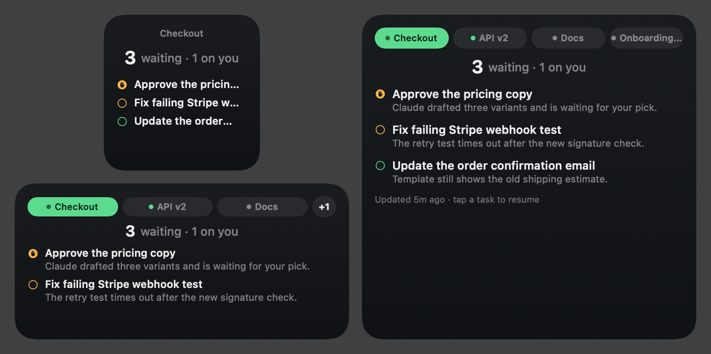
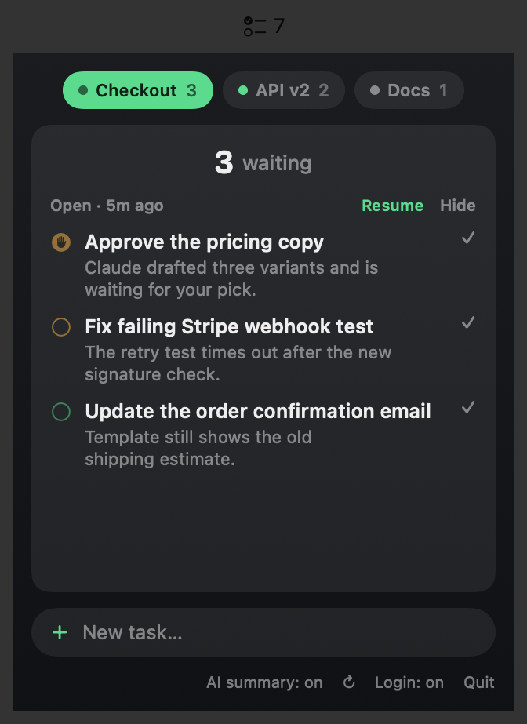

# Claude To-Do

A menu bar app and desktop widget that shows what is still unfinished across your Claude Code sessions, one tab per session.

- **Zero setup.** It reads Claude Code's own session files (`~/.claude`); no hooks, no config, nothing to type in.
- **Real to-dos, not chat snippets.** Each open item has a short title and a one-line explanation, and the ones waiting on *you* (an approval, a decision, a key) are marked and listed first.
- **Menu bar panel and a small/medium/large desktop widget**, with a tab per session. Tap a task to reopen that session with `claude --resume` in the terminal you use (Terminal, iTerm, Warp, Ghostty, …).
- Mark a task done, hide a tab, and add your own tasks in the "Mine" tab.
- Optional notification when something has been waiting on you for 15 minutes.

<p align="center">
  <br>
  
</p>

*Screenshots use made-up sample sessions.*

## Install

Homebrew (once a release is published):

```sh
brew install --cask muhammederem/claude-todo/claude-todo
```

or download `ClaudeTodo.dmg` from the Releases page and drag the app to Applications. Then add the widget: right-click the desktop, **Edit Widgets**, search "Claude To-Do".

Requires macOS 15+ and [Claude Code](https://claude.com/claude-code).

## How it works

1. A scanner reads the recent session transcripts in `~/.claude/projects` and the live-session registry in `~/.claude/sessions`.
2. When a session goes idle, your own `claude -p --model haiku` summarizes the end of the conversation into at most three open tasks. Results are cached and re-run only when the session changes.
3. The app publishes the result to a small JSON file that the widget reads.

## Privacy

Nothing leaves your machine except what Claude Code itself sends. The AI summary passes the tail of a conversation to the model **through your own `claude` CLI and login** (a few tenths of a cent per summary; no API key, no third-party service). Turn it off with **AI summary** in the panel footer; the app then falls back to simple rules and shows rougher results.

## Build from source

```sh
brew install xcodegen
DEVELOPMENT_TEAM=<your team id> scripts/build_app.sh   # build/ClaudeTodo.app
TEAM_ID=<id> scripts/release.sh                         # signed, notarized DMG (needs a Developer ID certificate)
```

Change the bundle identifiers in `project.yml` if you build it under your own team.

## License

MIT
